# Bot: qué es y cómo se usa

Este documento explica qué es la aplicación Bot, cómo funciona y cómo se
opera, sin entrar en detalles de programación. El detalle técnico está en
`docs/arquitectura.md` y `docs/operacion.md`.

Describe el software en sí, no un uso en particular. Lo que el Bot hace en
cada lugar depende de los flujos y los complementos que se le instalen.

**Documento relacionado.** El motor que ejecuta los flujos (bot-core) tiene
su propia descripción, que se mantiene por separado y viaja con cada versión
del motor:

- `backend/docs/descripcion/que-es-bot-core.md` (y su versión
  `que-es-bot-core.docx`), dentro de la carpeta del programa.

Este documento no repite lo que dice aquel: qué es un flujo, qué queda
registrado, quién puede hacer qué, cómo se comporta ante errores y qué
límites trae el motor están explicados ahí. Acá se cuenta la aplicación que
una persona usa para operarlo. Los términos del glosario del motor (flujo,
corrida, ítem, paso, complemento, herramienta, actor, traza, bitácora,
ensayo sin efectos, decisión manual) se usan con el mismo significado.

## Índice

1. En una frase
2. Las piezas
3. Cómo funciona
4. Cómo se usa, pantalla por pantalla
5. Instalación y actualización
6. Qué no hace
7. Glosario de la aplicación

## 1. En una frase

El Bot es la **aplicación que se abre en el navegador para operar el motor
bot-core**: muestra una lista de ítems traída de otro sistema y deja
ejecutar un flujo sobre cada uno, ver qué pasó y decidir cuando el flujo lo
pide.

## 2. Las piezas

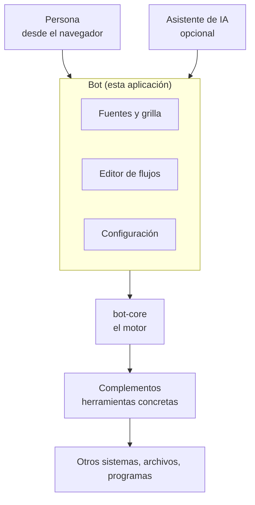

- **La aplicación (Bot):** las pantallas. Se instala en una PC con Windows
  (también corre en Linux) y se usa desde el navegador, en esa PC o desde
  otra de la misma red.
- **El motor (bot-core):** el que lee los flujos y los ejecuta paso a paso.
  Viene incluido en la aplicación. Ver el documento relacionado.
- **Los complementos:** el Bot se instala **sin ninguno**. Se agregan desde
  un catálogo que elige la organización.
- **Una instalación:** una carpeta en la PC con la configuración, la base de
  datos y la carpeta de trabajo de los flujos. Una misma PC puede tener más
  de una instalación.

## 3. Cómo funciona

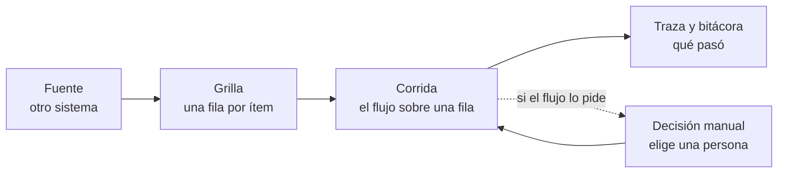

1. **La fuente.** El Bot se conecta a otro sistema (hoy, por su interfaz web
   o API) y trae una lista: pedidos, órdenes, archivos, lo que sea. Cada
   elemento de la lista es un **ítem**.
2. **La grilla.** Esa lista se muestra como una tabla, una fila por ítem, con
   las columnas que trae el sistema de origen más el estado de la última
   corrida de cada fila.
3. **La corrida.** Sobre una fila (o sobre varias seleccionadas) se ejecuta
   un flujo. El motor lo recorre paso a paso con los datos de esa fila.
4. **El registro.** Cada corrida deja su traza y suma líneas a la bitácora
   del ítem. Desde la grilla se ve, fila por fila, cómo terminó cada una.
5. **Las decisiones.** Si el flujo tiene un punto donde decide una persona,
   la fila queda **esperando** hasta que alguien elige el camino desde la
   pantalla.

Un flujo también puede **programarse** para que corra solo, cada cierto
tiempo o a una hora fija, aunque nadie tenga el navegador abierto.

## 4. Cómo se usa, pantalla por pantalla

La aplicación tiene cinco pestañas arriba: **Sources** (fuentes),
**Workflows** (flujos), **Plug ins** (complementos), **Agente** y
**Config**. A la izquierda, cada pestaña muestra su lista (las fuentes, los
flujos, los complementos o las secciones de configuración).

Las capturas de esta sección se tomaron de una instalación de prueba con
datos inventados.

### 4.1 Inicio

Es el resumen de la instalación. Se abre con la marca de arriba a la
izquierda.

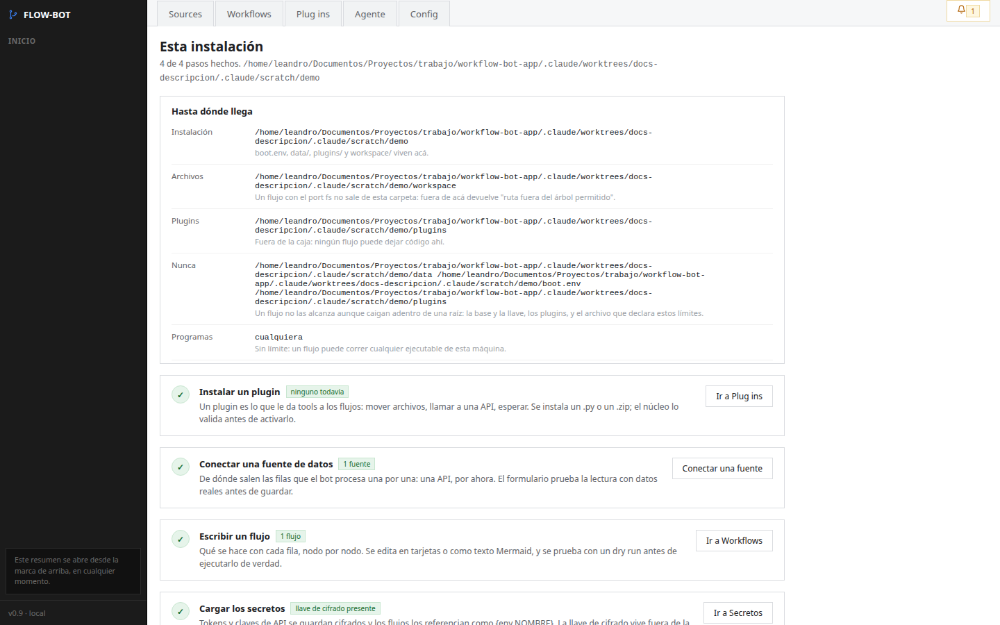{width=16cm}

- **Hasta dónde llega:** qué carpetas puede tocar un flujo, cuáles no puede
  tocar nunca (la base de datos, la llave y los complementos) y qué programas
  puede ejecutar.
- **Los pasos para dejarla lista:** instalar un complemento, conectar una
  fuente, escribir un flujo y cargar los secretos, con un botón que lleva a
  cada pantalla.

### 4.2 Sources: la grilla de ítems

Es la pantalla del día a día. Cada fuente conectada aparece a la izquierda;
al elegir una se ve su grilla.

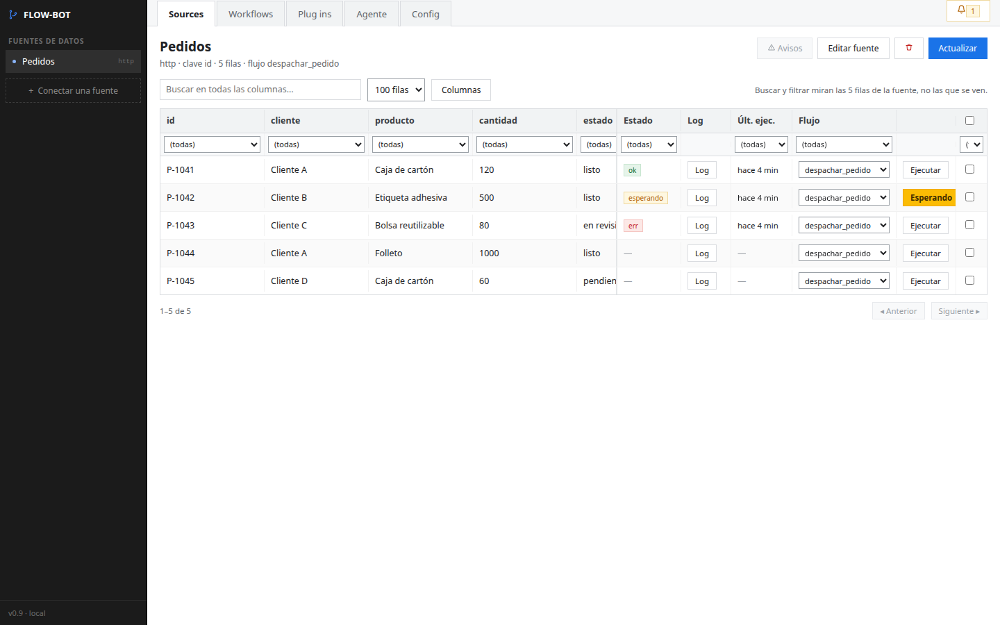{width=16cm}

- **Las columnas del sistema de origen** (en el ejemplo: id, cliente,
  producto, cantidad, estado). Se puede buscar en todas a la vez, filtrar
  cada una y elegir cuáles se muestran con **Columnas**.
- **Estado:** cómo terminó la última corrida de esa fila: *ok*, *err*
  (con error) o *esperando* (una decisión manual).
- **Log:** abre la bitácora del ítem.
- **Últ. ejec.:** cuándo corrió por última vez.
- **Flujo:** qué flujo se va a ejecutar sobre esa fila. Cada fuente tiene uno
  por defecto, y se puede cambiar fila por fila.
- **Ejecutar:** corre el flujo sobre esa fila. Con las casillas de la derecha
  se seleccionan varias filas y se ejecutan en tanda; la tanda se puede
  cortar a mitad de camino.
- **Actualizar:** vuelve a traer la lista del sistema de origen.

Mientras una fila corre, la columna Log muestra en qué paso va.

#### Cuando una fila está esperando una decisión

La fila muestra el botón **Esperando**. Al tocarlo se abre la decisión:

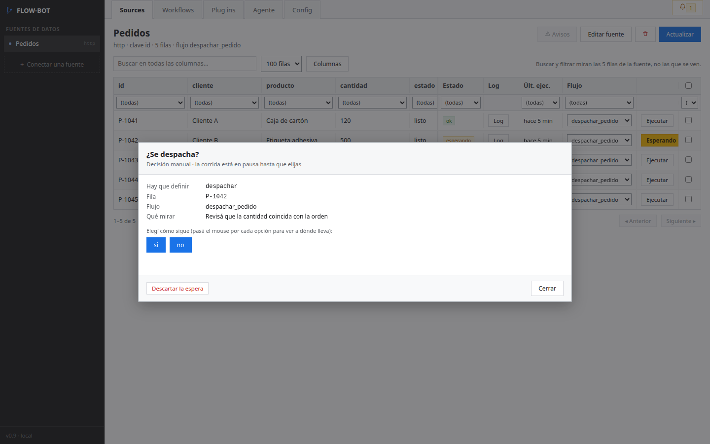{width=16cm}

Se ve qué hay que definir, de qué fila y de qué flujo se trata, y la ayuda
que dejó quien escribió el flujo ("Qué mirar"). Cada botón es un camino
posible. **Descartar la espera** cierra la corrida sin seguir. La elección
queda registrada con el nombre de quien la hizo.

#### La bitácora de un ítem

El botón **Log** muestra todo lo que le pasó a esa fila, de la corrida más
vieja a la más nueva:

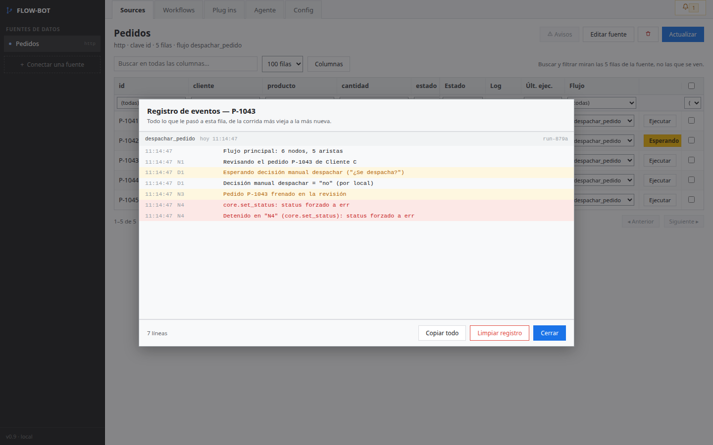{width=16cm}

Cada línea tiene la hora, el paso del flujo que la escribió y el mensaje. Las
advertencias se marcan en amarillo y los errores en rojo. En el ejemplo se ve
la decisión manual ("no", tomada por *local*) y el error con el que terminó la
corrida. **Copiar todo** sirve para pasarle el registro a otra persona.

### 4.3 Workflows: los flujos

Lista los flujos de la instalación y deja verlos, editarlos y probarlos.

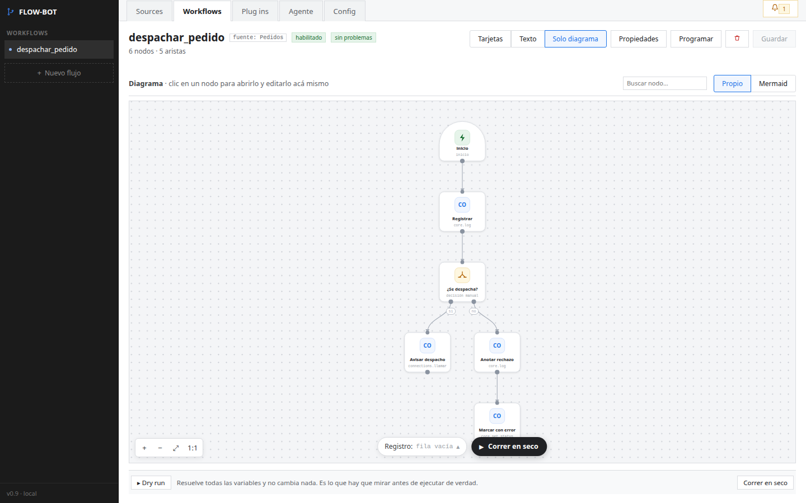{width=16cm}

Un flujo se puede mirar de tres maneras, que muestran lo mismo:

- **Tarjetas:** los pasos en orden, uno por tarjeta, con sus datos. Es la
  forma de editarlo sin escribir texto.
- **Texto:** el archivo del flujo tal como se guarda, en formato Mermaid.
- **Solo diagrama:** el dibujo completo. Se puede tocar un paso para abrirlo.

Arriba se ve si el flujo está **habilitado** y si tiene **problemas** (un paso
que usa una herramienta que no existe, un dato que falta). Además:

- **Propiedades:** el nombre, la fuente para la que está pensado y si está
  habilitado.
- **Programar:** que el flujo corra solo, cada cierto tiempo o en ciertos días
  y horarios. La pantalla muestra cuándo corrió y cuándo corre la próxima vez.
- **Guardar:** los cambios no se aplican hasta guardar.

#### Probar un flujo sin efectos

**Correr en seco** recorre el flujo con una fila de ejemplo sin hacer nada
que modifique algo (el *ensayo sin efectos* del motor). Muestra por qué
pasos iría, con los datos ya resueltos, y marca lo que no cierra:

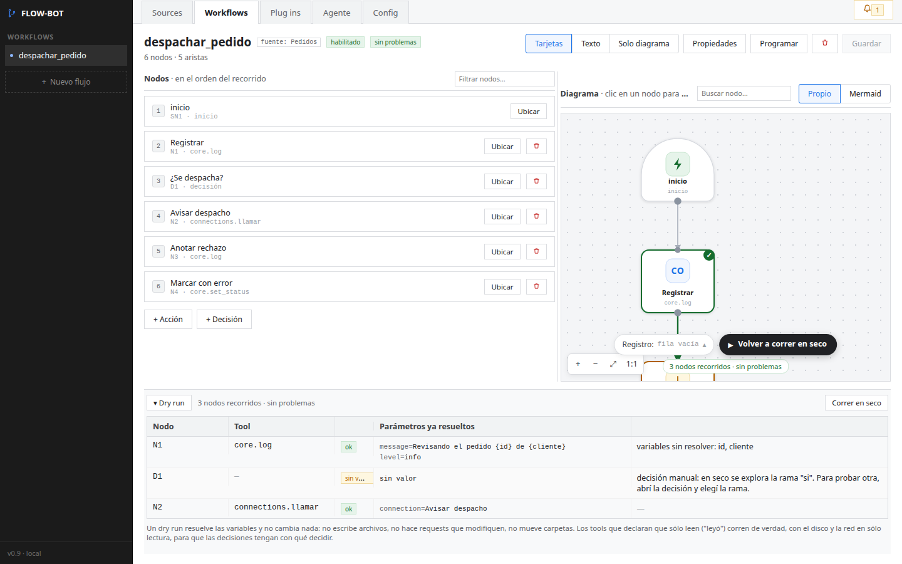{width=16cm}

En el ejemplo, el ensayo avisa que faltan datos de la fila (no se eligió
ninguna) y que en seco una decisión manual sigue siempre por la primera
opción.

### 4.4 Plug ins: los complementos

Muestra los complementos instalados y lo que cada uno aporta.

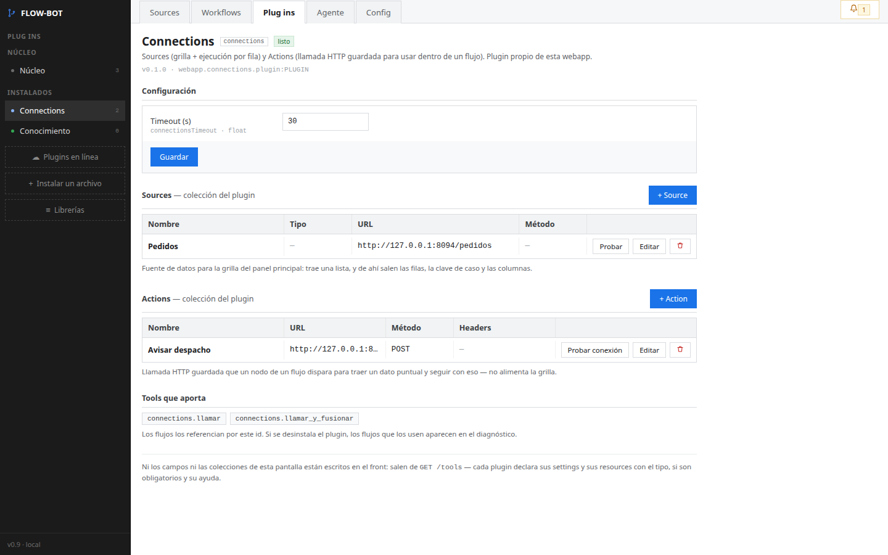{width=16cm}

Arriba a la izquierda está el **Núcleo** (el motor), con su configuración:
por ejemplo, cuánto tiempo y cuántas líneas se guardan de la bitácora.

Por cada complemento se ve su versión, su configuración, las herramientas que
aporta a los flujos y, si las tiene, sus **colecciones**: listas de elementos
guardados, como las fuentes o las llamadas a otros sistemas. Todo lo que
aparece en esta pantalla lo declara el propio complemento: la aplicación no
tiene pantallas hechas a medida para ninguno.

La aplicación trae dos complementos propios, que no se desinstalan:

- **Connections:** las **fuentes** (de dónde sale la grilla) y las
  **Actions** (una llamada guardada a otro sistema, que un paso del flujo
  puede usar).
- **Conocimiento:** notas sobre la instalación para el asistente de IA.

Para agregar otros:

- **Plugins en línea:** el catálogo de la organización. Muestra cada
  complemento con lo que hace y a qué accede (red, archivos, programas…).

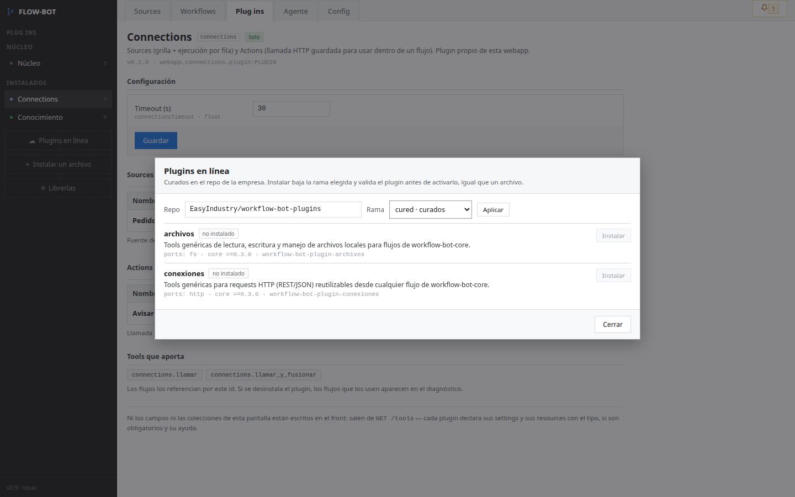{width=16cm}

- **Instalar un archivo:** para una PC sin internet.
- **Librerías:** las librerías de cálculo que piden algunos complementos.

Antes de instalar un complemento, la aplicación lo prueba aparte; si no
carga bien, no lo instala.

### 4.5 Agente: el asistente de IA (opcional)

Un asistente de IA puede escribir flujos y complementos en esta instalación.
Esta pestaña lo instala y lo conecta.

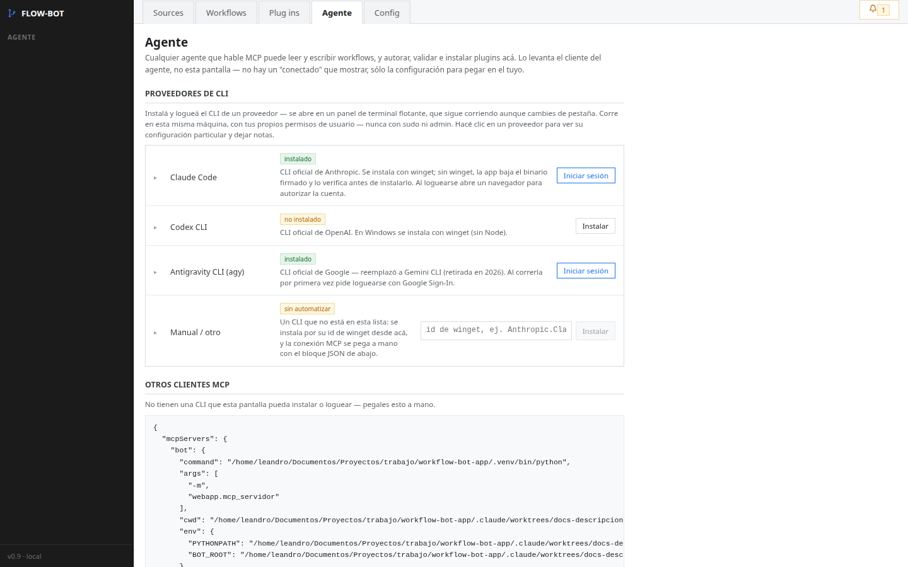{width=16cm}

- Lista los asistentes que se pueden instalar y su estado, y abre una
  terminal para iniciar sesión.
- Debajo está la configuración para conectar otros asistentes a mano.

El asistente no decide nada al ejecutar: lo que se ejecuta es el flujo
escrito. Corre como actor de tipo *agente*, con los permisos restringidos que
describe el documento del motor, y la instalación le deja un archivo con
las reglas y le pide que pruebe sin efectos antes de ejecutar. Usarlo es
opcional; el Bot funciona igual sin ninguno.

### 4.6 Config: la configuración

Las secciones de la izquierda son:

| Sección | Para qué |
|---|---|
| General | el nombre de este Bot |
| Configurar entorno | los **secretos** (contraseñas, claves) y las **variables** que usan los flujos |
| Almacenamiento | dónde se guarda la base de datos (un archivo en la PC) y si el cifrado de secretos está activo |
| Alcance | qué carpetas y programas puede usar un flujo |
| Diagnóstico | revisión de que la instalación esté bien armada |
| Base de datos | qué hay guardado, tabla por tabla, con los secretos tapados |
| Seguridad | los actores y qué puede hacer cada uno |
| Emparejamientos | conectar este Bot con otro, para pasarle flujos y configuración |
| Actualizaciones | traer versiones nuevas del motor y de la aplicación |

#### Secretos

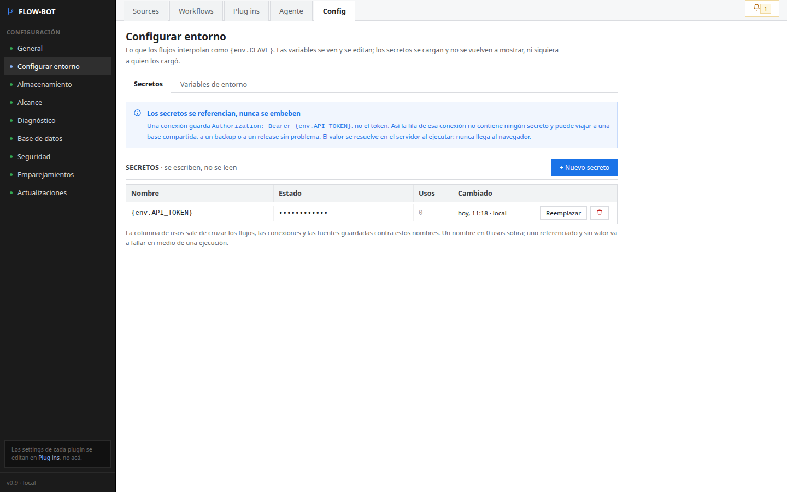{width=16cm}

Un secreto se carga una vez y **no se vuelve a mostrar**, ni siquiera a quien
lo cargó: se ve sólo que tiene valor, cuántas veces se usa y cuándo cambió.
Los flujos y las conexiones lo nombran (`{env.API_TOKEN}`) en vez de
contenerlo. Se guarda cifrado; la llave de cifrado vive en la carpeta de la
instalación y es lo único que hay que respaldar aparte.

#### Seguridad

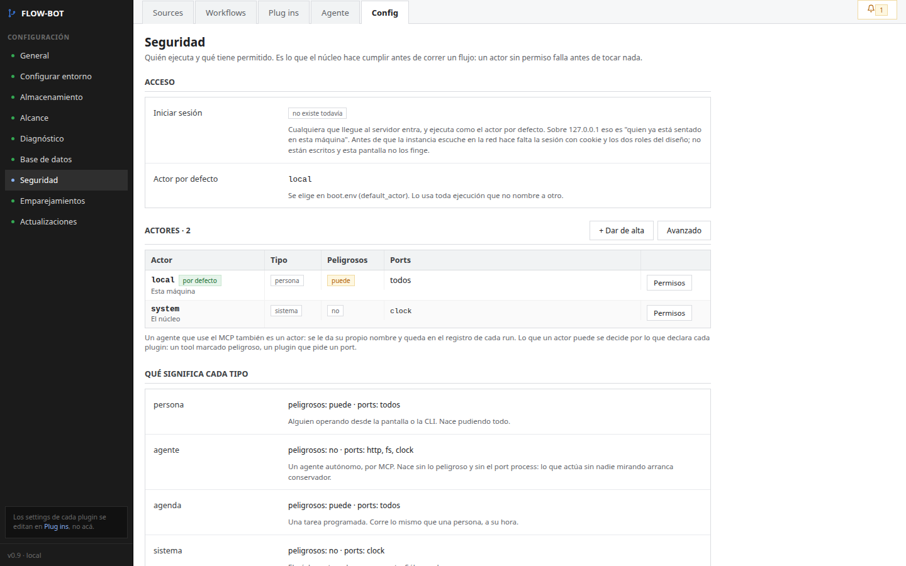{width=16cm}

Muestra los actores dados de alta, de qué tipo es cada uno (persona, agente,
tarea programada, sistema) y qué tiene permitido. Toda corrida queda a nombre
de un actor. La pantalla también dice lo que **todavía no existe**: el
inicio de sesión con usuario y contraseña (ver el punto 6).

#### Actualizaciones

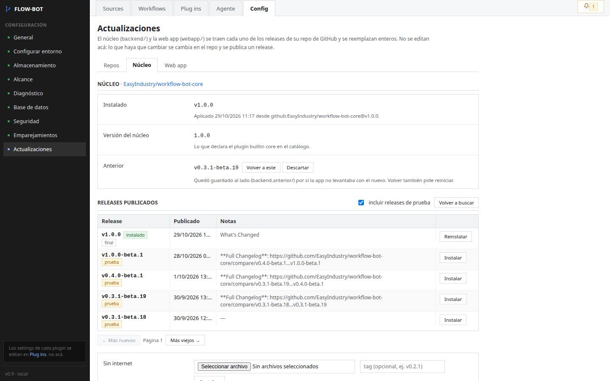{width=16cm}

Por separado para el motor y para la aplicación, se ve la versión instalada,
la anterior (guardada al lado por si hay que volver) y las versiones
publicadas. Ver el punto 5.

## 5. Instalación y actualización

### Instalar

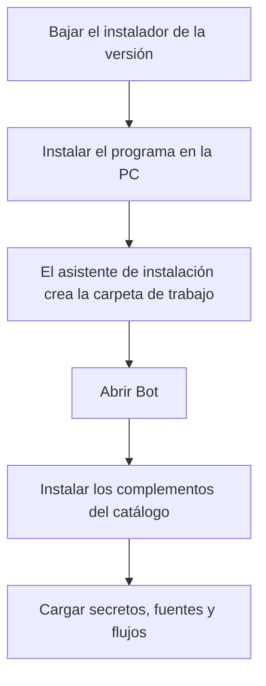

1. Se baja el instalador (`BotSetup-<versión>.exe`) de la versión publicada.
   Instala el programa para el usuario de Windows, sin pedir permisos de
   administrador.
2. Un asistente pide en qué carpeta va la instalación y la deja armada.
3. **Abrir Bot** levanta la aplicación, abre el navegador y deja un ícono en
   la bandeja del sistema, desde donde se copia la dirección para entrar
   desde otra PC de la red o se cierra.
4. Se instalan los complementos que haga falta desde el catálogo y se cargan
   los secretos, las fuentes y los flujos.

### Actualizar

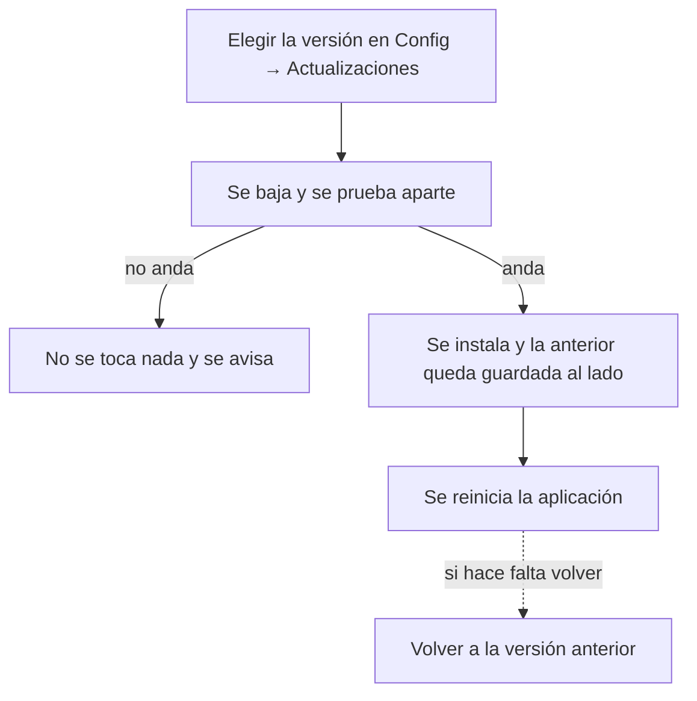

- El motor y la aplicación se actualizan por separado, desde **Config →
  Actualizaciones**, eligiendo una versión publicada. Una campana arriba a
  la derecha avisa cuando hay una nueva.
- Antes de instalarla, la versión nueva **se prueba en un proceso aparte**;
  si falla, no se toca nada.
- La versión anterior **queda guardada al lado** y se puede volver a ella con
  un botón (o, si la aplicación no llega a abrir, con un comando).
- Cada versión tiene un número único, así que siempre se sabe qué está
  instalado. Las de prueba llevan `-beta` en el número; una casilla deja
  ocultarlas y ver sólo las estables.
- **Sin internet:** se sube a mano el archivo de la versión.

## 6. Qué no hace

- **No tiene inicio de sesión.** Quien llega a la pantalla la usa como el
  actor por defecto de la instalación, y las corridas quedan a ese nombre.
  Por eso se usa dentro de la red interna: abierto con **Abrir Bot** se
  entra desde cualquier PC de la red local; arrancado sin la opción de red,
  sólo desde la misma PC. No está pensado para exponerse a internet.
- No trae complementos ni integraciones con ningún sistema: todos se instalan
  aparte, desde el catálogo que elige la organización.
- No contiene reglas de negocio. Qué se hace con cada ítem lo definen los
  flujos de cada instalación.
- No modifica el sistema de origen por sí solo: la grilla sólo lee. Si un
  flujo escribe en otro sistema, es porque un paso de ese flujo lo hace.
- No usa inteligencia artificial para ejecutar ni para decidir. El asistente
  de IA es opcional y sólo escribe flujos y complementos.
- No tiene una finalidad específica de una industria: es una herramienta
  general para operar procedimientos automatizados.

## 7. Glosario de la aplicación

Los términos del motor (flujo, corrida, ítem, paso, complemento, herramienta,
actor, traza, bitácora, ensayo sin efectos, decisión manual, Mermaid) están
en el glosario de `que-es-bot-core.md`. Estos son los propios de la
aplicación:

| Término | Qué significa |
|---|---|
| Instalación | La carpeta de una PC con la configuración, la base de datos y la carpeta de trabajo de un Bot. |
| Fuente (Source) | La conexión a otro sistema de donde sale la lista de ítems. |
| Grilla | La tabla que muestra los ítems de una fuente, una fila por ítem. |
| Action | Una llamada a otro sistema guardada con nombre, que un paso de un flujo puede usar. |
| Tanda | Varias filas ejecutadas una detrás de otra con el mismo flujo. |
| Programar | Hacer que un flujo corra solo, a intervalos o en ciertos días y horarios. |
| Correr en seco (Dry run) | El ensayo sin efectos del motor, lanzado desde la pantalla del flujo. |
| Registro de eventos (Log) | La bitácora de un ítem, como se ve en la pantalla. |
| Secreto | Una contraseña o clave guardada cifrada, que no se vuelve a mostrar. |
| Variable | Un valor de configuración que usan los flujos, visible y editable. |
| Catálogo (Plugins en línea) | El repositorio de complementos de donde se instalan. |
| Emparejamiento | La conexión entre dos Bots para pasar flujos y configuración de uno a otro. |
| Asistente de IA (Agente) | Un programa de IA que puede escribir flujos y complementos en la instalación. |
